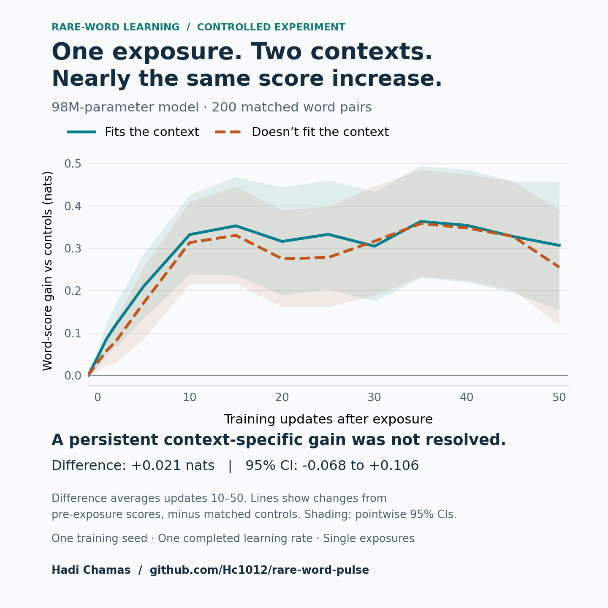

# What does one exposure teach a language model?

An experiment by Hadi Chamas.

I wanted to find out whether a small language model learns how to use a rare word after seeing it once. My original plan was to measure how quickly that knowledge faded. First, I needed to check that there was something to forget.

I continued training a public 98M-parameter BabyLM model and introduced 200 rare words once each. Another 200 matched words were not introduced and served as controls.

The exposed words became more likely in the test sentences where they fit. They also became more likely, by almost the same amount, in sentences where they did not fit. The experiment did not establish a lasting improvement in telling those contexts apart.

That failed the rule I had set for moving on to a longer forgetting test, so I stopped there.



## The result

These are changes relative to the matched controls, averaged over updates 10–50 after exposure. The score is the target word’s log probability, measured in nats.

| Test context | Score change | 95% interval |
|---|---:|---:|
| Appropriate context | +0.332 | [+0.226, +0.436] |
| Mismatched context | +0.312 | [+0.209, +0.415] |
| Difference between the two | +0.021 | [−0.068, +0.106] |

The interval for the difference includes zero. This does not prove that nothing was learned. It means this run did not provide clear evidence of the persistent contextual gain needed for the next experiment.

The [full figure](rare_word_learning_curves.png) also includes scores from the exposure excerpts. The [short report](Rare_Word_Pulse_Case_Study.pdf) covers the design and additional checks.

## What changed before the run

Review caught markup and spaced punctuation in 329 of the 400 candidate excerpts. Those patterns were cleaned without changing the selected words or their assignments.

An early comparison also mixed word frequency with tokenizer length. That threshold was replaced before exposure. Splitting the experiment into stages meant I could check the initial learning signal before committing to the longer run.

## Run the analysis yourself

Use Python 3.11 or later:

```bash
python -m pip install -r requirements.txt
python reproduce.py
python make_linkedin_figure.py
```

The first script rebuilds the statistics from `raw_scores.npz`, checks them against `analysis.json`, and saves the detailed figure and tables in `figures/`. The second rebuilds the chart above.

After installing dependencies, this takes seconds on CPU. No model download or GPU is needed. It reproduces the saved experiment’s analysis, not its training run. The frozen settings are in [protocol.json](protocol.json), and [provenance.json](provenance.json) records the source revisions and hashes.

## Limits

There was one completed run at a low learning rate (`5e-5`), with one exposure per treated word. A higher-rate branch stopped at a development-loss check before any exposure. Repeated exposures or another stable setting could produce a different result.

The intervals resample word pairs, not independent training runs. Most words had only one distinct appropriate context. Absence was checked in the continuation text, not across all of the model’s earlier training. Long-term forgetting was never tested.

The successful run took 7.1 minutes, estimated at 0.795 Colab units. That excludes the earlier profile, setup, idle time and the rest of the research project.

## Sources

The project used AI assistance for code, analysis and design review.

- [BabyLM public GPT-2 strict-small model](https://huggingface.co/BabyLM-community/BabyLM-2026-Baseline-GPT2-Strict-Small).
- [Algayres et al. (2025), LongTail-Swap](https://aclanthology.org/2025.findings-emnlp.601/) and its [official code](https://github.com/facebookresearch/lt-swap).
- [Chang and Bergen (2022), Word Acquisition in Neural Language Models](https://aclanthology.org/2022.tacl-1.1/).
- [Chang, Tu and Bergen (2024), Characterizing Learning Curves During Language Model Pre-Training](https://aclanthology.org/2024.tacl-1.74/).

The repository contains numerical scores and analysis code. It does not redistribute model weights, training text or test sentences.
